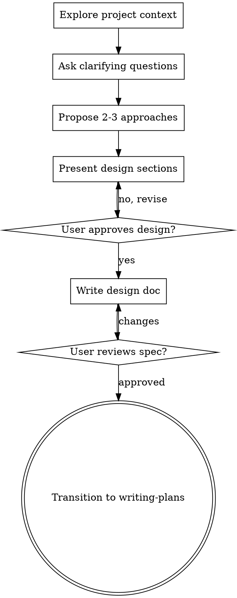

# Brainstorming — Design Before Code

**The most dangerous line of code is the one written without understanding the problem.**

This skill forces you to think before you type. It prevents the catastrophic waste of building the wrong thing well.

## Activation Condition

**This skill MUST be invoked when:**
- The user asks to build a new feature
- The user asks to add functionality
- The user asks to modify existing behavior
- The user asks to fix a bug (understand the problem first)
- The user asks to create a component
- The user asks to refactor code

**This skill is NEVER optional.** There is no task so simple that it skips design.

## Anti-Pattern: "This Is Too Simple To Need A Design"

**WRONG.** Every project goes through this process. A todo list, a single-function utility, a config change — ALL of them. "Simple" projects are where unexamined assumptions cause the most wasted work.

The design can be short (a few sentences for truly simple projects), but you MUST present it and get approval.

---

## Workflow



**The terminal state is invoking writing-plans.** Do NOT invoke any implementation skill. The ONLY skill you invoke after brainstorming is writing-plans.

---

## Execution Steps

### Step 1: Explore Project Context

Before asking ANY questions, you MUST understand what exists:

- Read the project's directory structure
- Read existing code files
- Read any existing documentation
- Check recent git commits
- Understand the tech stack

**You CANNOT ask good questions without context.**

### Step 2: Ask Clarifying Questions

**RULES for questions:**
- **ONE question per message.** Do NOT ask multiple questions at once.
- **Multiple choice preferred.** Give options A, B, C when possible.
- **Focus on purpose, constraints, and success criteria.**
- **Do NOT ask implementation questions yet.** Focus on WHAT and WHY, not HOW.

**Example question structure:**

```
What is the primary goal of this feature?

A) Improve user engagement
B) Reduce support tickets
C) Add new revenue stream
D) Something else (please describe)
```

**Keep asking until you understand:**
- What problem are we solving?
- Who is the user?
- What does success look like?
- What are the constraints?
- What is explicitly NOT in scope?

### Step 3: Propose 2-3 Approaches

**MANDATORY: You MUST propose at least 2 different approaches.**

Each approach must include:
- **Description** — What is this approach?
- **Pros** — Why might this be good?
- **Cons** — Why might this be bad?
- **Your recommendation** — Which do you prefer and why?

**Present options conversationally. Lead with your recommended option.**

**Example:**

```
I see three approaches:

**Option A: Server-side rendering (Recommended)**
- Pros: Better SEO, faster initial load
- Cons: More server load, complex caching
- Best for: Public-facing pages

**Option B: Client-side rendering**
- Pros: Simpler server, richer interactions
- Cons: Slower initial load, worse SEO
- Best for: Dashboard/admin areas

**Option C: Static generation with revalidation**
- Pros: Best performance, CDN-friendly
- Cons: Stale data possible, complex invalidation
- Best for: Content that changes rarely

My recommendation: Option A. The SEO benefits are critical for this use case.
```

### Step 4: Present Design in Sections

Once you understand the requirements, present the design section by section.

**RULES:**
- **Scale sections to complexity.** A few sentences if straightforward, up to 200-300 words if nuanced.
- **Ask after EACH section:** "Does this look right so far?"
- **Cover these areas:**
  - Architecture overview
  - Components and their responsibilities
  - Data flow
  - Error handling
  - Testing strategy
  - File structure

**Design for isolation and clarity:**
- Break the system into smaller units
- Each unit has ONE clear purpose
- Units communicate through well-defined interfaces
- Each unit can be understood and tested independently

**For each unit, answer:**
- What does it do?
- How do you use it?
- What does it depend on?

### Step 5: Write Design Document

After user approval, save the design to:

```
docs/specs/YYYY-MM-DD-<topic-slug>-design.md
```

**Format:**

```markdown
# [Feature Name] Design Document

> Created: YYYY-MM-DD
> Status: Approved

## Problem Statement
[What problem are we solving?]

## Requirements
### Must Have
- [ ] ...

### Must NOT Have
- [ ] ...

## Architecture
[Diagram and description]

## Components
### Component 1
- Responsibility: ...
- Interface: ...
- Dependencies: ...

## Data Flow
[How data moves through the system]

## Error Handling
[What errors can occur and how we handle them]

## Testing Strategy
[How we will test this]

## File Structure
[New files and their purposes]
```

### Step 6: User Reviews Written Spec

**MANDATORY: Wait for user approval of the written spec.**

After writing the spec, say:

> "Spec written and saved to `docs/specs/<filename>`. Please review it and let me know if you want any changes before we move to implementation planning."

**Wait for the user's response.** If they request changes, make them and ask again. Only proceed when the user approves.

### Step 7: Transition to Implementation

**Once the spec is approved, invoke the writing-plans skill.**

```bash
# The ONLY skill to invoke after brainstorming
# Invoke: 02-writing-plans
```

**Do NOT invoke any other skill.** Writing-plans is the ONLY next step.

---

## Key Principles

| Principle | Rule |
|-----------|------|
| **One question at a time** | Never overwhelm with multiple questions |
| **Multiple choice preferred** | Easier to answer than open-ended |
| **YAGNI ruthlessly** | Remove unnecessary features from all designs |
| **Explore alternatives** | Always propose 2-3 approaches |
| **Incremental validation** | Present design, get approval section by section |
| **Be flexible** | Go back and clarify when something doesn't make sense |

---

## Verification Checklist

Before completing brainstorming:

- [ ] Explored project context (files, docs, commits)
- [ ] Asked clarifying questions (one at a time)
- [ ] Proposed 2-3 approaches with trade-offs
- [ ] Presented design in sections
- [ ] User approved each section
- [ ] Wrote design document to `docs/specs/`
- [ ] User approved written spec
- [ ] Invoked writing-plans skill

**Can't check all boxes? You didn't finish brainstorming. Complete the missing steps.**

---

## Common Rationalizations

| Excuse | Reality |
|--------|---------|
| "The user seems in a hurry" | A bad design wastes MORE time than a good one |
| "This is obviously simple" | Simple projects have the most hidden complexity |
| "I already know the answer" | You might be wrong. Test your assumptions |
| "The user will get annoyed" | The user will get MORE annoyed by the wrong implementation |
| "I can refactor later" | Refactoring is 10x more expensive than designing right |

---

**The goal of brainstorming is NOT to delay implementation. It is to ensure we build the RIGHT thing.**
