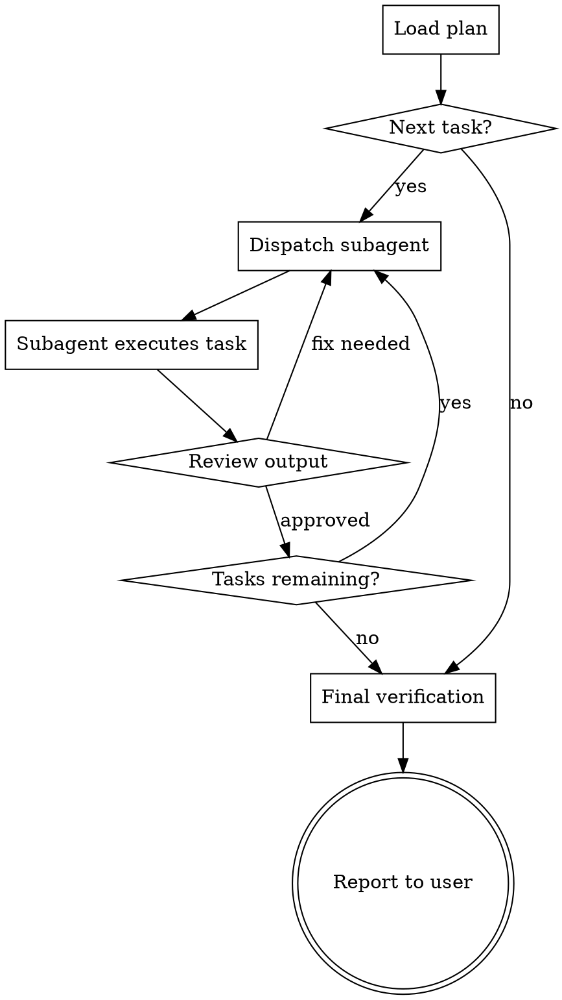

# Executing Plans — Subagent Dispatch with Review

**A plan without execution is fiction. This skill turns plans into working code, one task at a time.**

## Activation Condition

**This skill MUST be triggered when:**
- A plan has been written by the `02-writing-plans` skill
- The user has approved the plan
- The user chose "Subagent-Driven" or "Inline Execution"

**This skill is NEVER skipped.** No code is written outside the plan structure.

---

## Overview

This skill has two execution modes:

| Mode | When to Use | How It Works |
|------|-------------|--------------|
| **Subagent-Driven** | Recommended for most cases | Fresh subagent per task, review between tasks |
| **Inline Execution** | Small plans, quick changes | Execute in current session with checkpoints |

---

## Mode 1: Subagent-Driven (Recommended)

### Process Flow



### Step 1: Load the Plan

Read the plan file completely. Understand:
- The goal
- The architecture
- The file structure
- Every task and its steps

### Step 2: Dispatch Subagent Per Task

For each task, launch a fresh subagent with:

```
Task: [Task description from plan]
Files: [Files to create/modify from plan]
Steps:
1. [Step 1 with exact code]
2. [Step 2 with exact command]
3. [Step 3 with exact code]
...

CRITICAL RULES:
- Follow the steps EXACTLY as written
- Do NOT deviate from the plan
- Do NOT add features beyond what's specified
- Do NOT skip test verification
- Run every command and show output
- Commit after completing all steps
```

### Step 3: Two-Stage Review

After each subagent completes, review:

**Stage 1: Spec Compliance**
- [ ] Did the subagent follow ALL steps?
- [ ] Did every test fail before implementation?
- [ ] Did every test pass after implementation?
- [ ] Was the commit message correct?
- [ ] Were the right files modified?

**Stage 2: Code Quality**
- [ ] Is the code clean and readable?
- [ ] Are there any obvious issues?
- [ ] Does it follow the codebase patterns?
- [ ] Are there any leftover debug statements?

**If review fails:**
1. Identify what went wrong
2. Fix the issue (or dispatch a new subagent with specific instructions)
3. Re-review

### Step 4: Continue or Complete

- **More tasks?** Dispatch next subagent
- **All tasks done?** Run final verification

---

## Mode 2: Inline Execution

### When to Use

- Plans with fewer than 5 tasks
- Quick changes that don't need subagent overhead
- When the user prefers to watch progress in real-time

### Process

1. **Announce:** "Executing plan inline. I'll show progress after each task."
2. **Execute each task** in the current session
3. **Show output** after each step
4. **Checkpoint** after every 3-5 tasks:
   - "Tasks 1-3 complete. All tests passing. Continuing..."
5. **Report** when all tasks are done

---

## Two-Stage Review — Detailed

### Stage 1: Spec Compliance

For every task, verify:

| Check | How to Verify |
|-------|---------------|
| Test failed first | Look at subagent output — did it show FAIL? |
| Test passed after | Look at subagent output — did it show PASS? |
| Correct files modified | `git diff --name-only` |
| Commit made | `git log --oneline -1` |
| No deviations | Compare code to plan — exact match? |

### Stage 2: Code Quality

For every task, verify:

| Check | How to Verify |
|-------|---------------|
| No placeholder code | Read the actual code |
| Tests are meaningful | Test describes behavior, not implementation |
| Minimal implementation | Code does exactly what test requires, nothing more |
| Clean commit | Message follows conventional format |
| No unrelated changes | `git diff` shows only planned changes |

---

## Handling Failures

### Subagent Fails to Complete Task

1. **Check if test failed correctly** — If yes, fix implementation
2. **Check if test had wrong assertion** — Fix test, restart task
3. **Check if subagent deviated from plan** — Re-dispatch with stricter instructions
4. **Check if plan was wrong** — Update plan, then re-execute

### Test Fails After Implementation

1. **Read the error message carefully**
2. **Determine if it's a test issue or implementation issue**
3. **Fix the MINIMUM necessary**
4. **Re-run tests to verify**
5. **Do NOT move to next task until tests pass**

### Multiple Tests Fail

1. **Fix one at a time** — Don't try to fix everything at once
2. **Start with the first failure** — Tests run in order
3. **Verify each fix** — Run tests after each change
4. **Check for cascading failures** — One fix may resolve multiple failures

---

## Final Verification

After all tasks are complete:

```bash
# Run full test suite
npm test

# Check for lint errors
npm run lint

# Check for type errors
npm run typecheck

# Review all changes
git log --oneline

# Check coverage (if applicable)
npm run test:coverage
```

**ALL of these must pass before reporting success to the user.**

---

## Reporting to User

After final verification, report:

```
Plan execution complete.

**Tasks completed:** X/Y
**Tests passing:** Z
**Coverage:** XX%

**Summary of changes:**
- [List files created/modified]

**Commits:**
- [List commit messages]

**Issues encountered:** [None / Description]
```

---

## Verification Checklist

Before completing execution:

- [ ] All tasks from the plan executed
- [ ] Two-stage review performed for each task
- [ ] All tests pass (full suite)
- [ ] No lint errors
- [ ] No type errors
- [ ] All commits follow conventional format
- [ ] Final report delivered to user

**Can't check all boxes? Find and fix the gaps before reporting success.**
